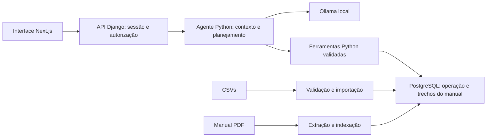

# Empório da Música

Protótipo de agente de atendimento por texto para a loja fictícia Empório da Música,
desenvolvido para o desafio técnico de AI Engineer da Artefact. O objetivo é
consultar produtos, preços, disponibilidade, pedidos e políticas com informações
das fontes fornecidas, mantendo o contexto da conversa e os limites do atendimento.

Implementei o agente em Python, com API Django, PostgreSQL, Ollama local e uma
interface Next.js. A demonstração pode usar o material original do desafio ou
fixtures sintéticas públicas, em **bancos separados**. Não há treinamento ou
fine-tuning: o modelo consulta informações por ferramentas executadas pelo backend.

**Estado atual:** protótipo com execução local, avaliações reais, testes automatizados
e frontend publicado na Vercel com uma base sintética exclusiva para a demonstração.
O modelo ainda apresenta limitações de interpretação e latência. A consulta de
violões até R$ 1.000 tem uma falha relatada nos testes manuais mais recentes e
continua pendente de investigação. Os exemplos selecionados não representam
aprovação geral do agente para qualquer pergunta.

## Guia de leitura

- [Demonstração na Vercel e operação do túnel](docs/deploy-vercel.md)
- [Executar um ambiente já preparado](#executar-um-ambiente-já-preparado)
- [Instalação completa](#instalação-completa)
- [Escolher e preparar os dados](#escolher-e-preparar-os-dados)
- [Entrar na demonstração](#entrar-na-demonstração)
- [Como pensei e organizei o sistema](#como-pensei-e-organizei-o-sistema)
- [Por que as respostas podem demorar](#por-que-as-respostas-podem-demorar)
- [Limitações e próximos passos](#limitações-e-próximos-passos)
- [Conversas reais e verificações](#conversas-reais-e-verificações)

## Executar um ambiente já preparado

Se o projeto, o modelo e os dados já estiverem instalados, não é necessário
repetir as importações. Execute os comandos na raiz do repositório.

**Com os dados originais do desafio:**

```sh
docker compose -f compose.yaml -f compose.original.yaml up -d
docker compose -f compose.yaml -f compose.original.yaml ps
```

Abra [http://localhost:3000](http://localhost:3000). Para emitir um novo acesso:

```sh
docker compose -f compose.yaml -f compose.original.yaml exec backend python manage.py create_demo_access --customer-id 1 --hours 24
```

Use somente o `access_token` retornado no campo da interface. Não publique o token.

**Com os dados sintéticos:**

```sh
docker compose -f compose.yaml up -d
docker compose -f compose.yaml exec backend python manage.py create_demo_access --customer-id 1 --hours 24
```

Recarregue a página após alternar. O arquivo `compose.original.yaml` precisa ser
informado a cada inicialização do modo original. Usar apenas `compose.yaml`
seleciona a base padrão, normalmente sintética. A troca não exige editar o `.env`.

## Stack e estrutura

| Camada | Tecnologia e responsabilidade |
| --- | --- |
| Agente e domínio | Python 3.12; planejamento, ferramentas, verificações e regras de negócio |
| API | Django 5.2 e Django REST Framework; sessão, CSRF, autorização e contratos HTTP |
| Documentação HTTP | OpenAPI e Swagger UI com drf-spectacular |
| Persistência | PostgreSQL 17; catálogo, pedidos, políticas indexadas e conversas |
| Inferência | Ollama local; avaliações com `qwen3:1.7b` |
| Interface | Next.js, React e TypeScript |
| Ambiente local | Docker Compose |

```text
backend/              Apps Django, agente, ferramentas, migrations e testes
frontend/             Interface de chat e cliente HTTP
compose.yaml          Ambiente local padrão
compose.original.yaml Configuração adicional para a base original
data/synthetic/       Seis CSVs e PDF sintéticos públicos
data/private/         Cópias dos arquivos originais, ignoradas pelo Git
docs/examples/        Cinco conversas selecionadas para demonstração
docs/validation/      Relatórios, testes e execuções anteriores identificadas
scripts/              Avaliações locais e exportação controlada de exemplos
docker/               Dockerfiles dos serviços
```

## Instalação completa

### 1. Pré-requisitos e clone

É necessário ter Docker Engine ou Docker Desktop com Docker Compose v2, Git e
acesso à internet para obter imagens, dependências e o modelo. Para o caminho
completo por Docker, não é necessário instalar Python ou Node no host.

A inferência usa CPU no ambiente avaliado; não há configuração de GPU no Compose.
É necessário espaço para imagens, banco e pesos do modelo, além de memória
compatível com esses serviços. Não estabeleci um requisito mínimo universal de
hardware; os tempos medidos estão documentados adiante.

```sh
git clone https://github.com/BrunoAndrade-dev/AI_-Agent.git
cd AI_-Agent
docker compose version
```

Mantenha o mesmo diretório/projeto Compose ao reutilizar uma instalação existente,
para continuar usando seus volumes de banco e modelo.

### 2. Configurar o ambiente

Crie o arquivo local somente se ele ainda não existir:

```sh
[ -f .env ] || cp .env.example .env
```

Edite o `.env` e preencha `DJANGO_SECRET_KEY` e `POSTGRES_PASSWORD` com valores
privados, fortes e diferentes. Uma forma de gerar dois valores sem Python no host:

```sh
docker run --rm python:3.12-slim python -c "import secrets; print('DJANGO_SECRET_KEY=' + secrets.token_urlsafe(48)); print('POSTGRES_PASSWORD=' + secrets.token_urlsafe(48))"
```

Copie os valores para os campos correspondentes do `.env`; não os inclua no Git,
em capturas ou nos exemplos de atendimento. Preserve as credenciais de uma
instalação existente: trocar a senha no arquivo não altera a senha de um banco
já inicializado no volume.

Confira também estas configurações públicas:

```dotenv
DJANGO_DEBUG=true
DJANGO_ALLOWED_HOSTS=localhost,127.0.0.1,backend
DJANGO_CORS_ALLOWED_ORIGINS=http://localhost:3000
POSTGRES_DB=emporio
POSTGRES_USER=emporio
POSTGRES_HOST=db
POSTGRES_PORT=5432
OLLAMA_BASE_URL=http://ollama:11434
OLLAMA_MODEL=qwen3:1.7b
OLLAMA_TIMEOUT_SECONDS=120
NEXT_PUBLIC_API_BASE_URL=http://localhost:8000/api
```

O `.env.example` ainda indica o candidato anterior `qwen3:4b`. Para reproduzir
as avaliações deste repositório, configure explicitamente **`qwen3:1.7b`**.
Alterações de variáveis do container exigem reaplicar `docker compose up -d`;
a configuração pública do frontend também precisa ser atualizada no processo que o executa.

### 3. Construir e iniciar os serviços

```sh
docker compose up --build -d
docker compose ps
```

Os serviços são `db`, `ollama`, `backend` e `frontend`. O banco e o Ollama não
publicam portas no host; o backend é exposto em `127.0.0.1:8000`, e o frontend
Docker, em `127.0.0.1:3000`. Healthcheck saudável não comprova que o modelo foi
baixado nem que o agente produz respostas corretas.

### 4. Preparar o modelo

Confira os modelos instalados:

```sh
docker compose exec -e OLLAMA_HOST=http://127.0.0.1:11434 ollama ollama list
```

Se `qwen3:1.7b` ainda não estiver disponível, faça o download:

```sh
docker compose exec -e OLLAMA_HOST=http://127.0.0.1:11434 ollama ollama pull qwen3:1.7b
```

Os pesos ficam no volume do Ollama, fora do Git e da imagem do backend. Não é
necessário baixar novamente a cada inicialização. Não há chave de provedor pago.

## Escolher e preparar os dados

Escolha uma das alternativas abaixo. **Não importe os originais sobre a base
sintética**, pois os IDs podem coincidir e o importador atualiza registros por ID.
Somente um dos modos atende pela porta 8000 de cada vez.

| Modo | Fonte | Banco |
| --- | --- | --- |
| Original, para demonstrar o material do desafio | CSVs fornecidos e manual v2.1 | `emporio_original` |
| Sintético, para reprodução pública sem os anexos | `data/synthetic` e `policies-demo.pdf` | Valor de `POSTGRES_DB`, padrão `emporio` |

### Opção A — material original do desafio

Coloque os seis CSVs em `data/private`:

```text
data/private/
  categories.csv
  products.csv
  customers.csv
  orders.csv
  order_items.csv
  promotions.csv
  policies.pdf
```

Os CSVs também aceitam nomes como `desafio_tecnico_ai_eng - products.csv`.
Mantenha apenas uma convenção por tabela. Copie o manual `políticas_da_loja.pdf`
como `policies.pdf`, sem modificar seu conteúdo. Os originais completos não
acompanham o repositório público; o avaliador precisa usar o material recebido.

Com os serviços iniciados na etapa anterior:

```sh
docker compose exec backend python manage.py create_original_database
docker compose -f compose.yaml -f compose.original.yaml run --rm --no-deps backend python manage.py migrate
docker compose -f compose.yaml -f compose.original.yaml run --rm --no-deps backend python manage.py import_store_data --directory /data/private
docker compose -f compose.yaml -f compose.original.yaml run --rm --no-deps backend python manage.py ingest_policies /data/private/policies.pdf --document-version 2.1
docker compose -f compose.yaml -f compose.original.yaml up -d
```

O primeiro comando cria o banco separado se ele não existir; não apaga um banco
existente. O importador valida arquivos e relacionamentos antes da gravação,
faz a importação atomicamente e pode atualizar registros em reimportações.
Não elimina registros ausentes dos arquivos.

O material fornecido contém 9 categorias, 65 produtos, 50 clientes, 20 pedidos,
22 itens e 25 promoções. O manual tem oito páginas e gerou 28 trechos indexados.
O modo original usa cookie próprio, preservando a sessão da base sintética.

### Opção B — dados sintéticos públicos

Na base padrão vazia ou já dedicada às fixtures:

```sh
docker compose -f compose.yaml up -d
docker compose -f compose.yaml exec backend python manage.py migrate
docker compose -f compose.yaml exec backend python manage.py import_store_data --directory /data/synthetic
docker compose -f compose.yaml exec backend python manage.py ingest_policies /data/synthetic/policies-demo.pdf --document-version demo
```

Essa base possui 2 categorias, 5 produtos, 2 clientes, 2 pedidos, 2 itens e
2 promoções, além de um PDF sintético de duas páginas. Ela permite reproduzir
consultas e regras sem divulgar contatos ou arquivos originais.

## Entrar na demonstração

Depois de preparar a base escolhida, confira o modelo e emita um acesso.
**No modo original:**

```sh
docker compose -f compose.yaml -f compose.original.yaml exec backend python manage.py chat_store --check-model
docker compose -f compose.yaml -f compose.original.yaml exec backend python manage.py create_demo_access --customer-id 1 --hours 24
```

**No modo sintético:**

```sh
docker compose -f compose.yaml exec backend python manage.py chat_store --check-model
docker compose -f compose.yaml exec backend python manage.py create_demo_access --customer-id 1 --hours 24
```

O comando retorna `access_id`, `access_token` e `expires_at`. Abra
[http://localhost:3000](http://localhost:3000) e cole **apenas o `access_token`**.
O código pertence à base em que foi emitido; um token sintético não autentica na
base original. O cliente 1 deve existir nessa base. A seleção de cliente é uma
facilidade do operador local, não uma verificação de identidade de clientes reais.

O navegador recebe uma sessão HttpOnly. O token bruto não é armazenado no banco
nem em localStorage. A API exige CSRF inclusive no login e renova o token CSRF
após autenticar. Outro login recebe um escopo novo de histórico, mesmo usando o
mesmo acesso; encerrar e entrar novamente não reabre o escopo anterior.

Para conversar pelo terminal no modo original:

```sh
docker compose -f compose.yaml -f compose.original.yaml exec backend python manage.py chat_store --customer-id 1
```

Digite `/sair` para encerrar. O CLI mantém contexto somente durante esse processo;
o histórico da interface é persistido pela API e tem isolamento próprio.

### Frontend em desenvolvimento na porta 3001

O frontend Docker usa a porta 3000. Opcionalmente, com Node.js 24 no host, é possível
rodar a interface local enquanto os serviços de backend continuam no Docker:

```sh
cd frontend
npm ci
npm run dev -- --port 3001
```

Abra [http://localhost:3001](http://localhost:3001). As duas origens
`http://localhost:3000` e `http://localhost:3001` são permitidas pelo Compose para
CORS e CSRF. A API continua em `http://localhost:8000/api`. Outras portas ou hosts
exigem configuração explícita. Nenhum segredo deve ir em variáveis `NEXT_PUBLIC_*`.

### API e Swagger

- [Health](http://localhost:8000/api/health/): liveness do processo.
- [Swagger UI](http://localhost:8000/api/docs/): contratos e execução de endpoints.
- [OpenAPI](http://localhost:8000/api/schema/): esquema da API.

O fluxo HTTP começa em `GET /api/chat/session/` para obter CSRF, seguido de
`POST /api/chat/session/` com o acesso. Após login, use o CSRF renovado nos writes.
Conversas usam `/api/chat/conversations/`; mensagens usam
`/api/chat/conversations/{id}/messages/`. O passo a passo do Swagger está em
[documentação da API](docs/api.md).

## Como pensei e organizei o sistema

Escolhi separar interpretação de linguagem, acesso aos dados, regras de negócio
e transporte HTTP. O modelo decide o que consultar; o backend controla o que pode
ser executado e quais fatos serão apresentados. Assim consigo testar preços,
autorização e persistência independentemente da geração de texto.



### Dados e decisões

Optei por manter os CSVs originais de clientes, os demais arquivos originais,
as credenciais, o banco e os pesos do modelo fora do versionamento. Para permitir
a reprodução pública do projeto, disponibilizo fixtures inteiramente sintéticas.
Mantenho as duas bases separadas porque seus IDs podem coincidir.

Usei PostgreSQL, ORM e migrations para ter relacionamentos, constraints e
transações verificáveis. Os domínios ficam em apps separados: `catalog`,
`customers`, `orders`, `knowledge`, `chat` e infraestrutura em `core`.
Escolhi Django/DRF para aproveitar autenticação, validação e organização de API.
A interface Next.js fica responsável pela interação; ela não acessa o banco ou o
Ollama diretamente.

Preservo os totais históricos dos pedidos, mesmo quando diferem do catálogo atual,
e não uno clientes que compartilham e-mail. Oriento o agente a reconhecer campos
ausentes e conflitos do manual; a fidelidade dessa interpretação ainda depende
do modelo. Detalhes: [dados e importação](docs/data-import.md).

### Ferramentas e regras executadas em Python

| Ferramenta | Uso |
| --- | --- |
| `search_products` | Busca por nome, categoria, orçamento e disponibilidade |
| `get_product` | Consulta atual de um produto por ID |
| `get_order` | Consulta de pedido no escopo do cliente autenticado |
| `search_policies` | Recuperação de trechos do manual com página, seção e versão |

Calculo preços com `Decimal` e arredondamento comercial. Disponibilidade exige
status `active` e estoque positivo. A vigência da promoção segue o `is_active`
fornecido, sem inferir datas pelo nome da campanha. Uma promoção ativa define o
preço atual; sem promoção, o PIX recebe 5% de desconto sobre tabela. O PIX não acumula desconto sobre preço
promocional. O filtro de orçamento usa o preço atual, sem presumir pagamento no PIX.

O modelo não escreve SQL. O código valida nome da ferramenta, tipos e argumentos.
Filtros numéricos e referências de produto são limitados pelo contexto; o filtro
de categoria depende de palavras reconhecidas na mensagem. Essas restrições
reduzem invenções, mas não substituem interpretação semântica.

Não aceito `customer_id` escolhido por mensagem HTTP ou pelo modelo. O backend
obtém a identidade da sessão e não revela pedidos de outro cliente. Rastreio e
status vêm do banco local, sem consulta ao vivo à transportadora.

### Retrieval e estratégia de prompt

Para o manual pequeno, escolhi busca lexical com normalização de acentos,
sinônimos e ranking do tipo BM25. Não adicionei embeddings ou banco vetorial nesta
etapa. Extraio o PDF em trechos por seção/página, com versão e checksum para
rastreabilidade. O índice fica no PostgreSQL; não há OCR para PDFs digitalizados.

O prompt define persona acolhedora e objetiva, escopo da loja, obrigação de
consultar fontes e limites de atuação. O planejamento inicial usa JSON Schema
para escolher ferramenta/argumentos ou uma intenção simples de saudação,
esclarecimento ou fora de escopo. Depois das consultas, o modelo pode pedir outras
ferramentas. Textos recuperados e mensagens do cliente são tratados como dados.

Limitei o loop a quatro rodadas e oito chamadas de ferramentas, com contexto
reduzido. O histórico identifica o assunto, mas não substitui consultas atuais.
No seguimento curto “E no PIX?”, uma referência única exige nova consulta ao
produto; com contexto ambíguo, o agente pede esclarecimento.

A aplicação formata os resultados de catálogo e pedidos a partir dos fatos
consultados. Também mantém orientação conservadora de devolução e exige a regra
do manual para PIX com promoção. Esses trechos não são redação livre do LLM.
As verificações parciais de evidência e valores não certificam cada frase gerada.

Escolhi um loop explícito, sem framework pesado de agentes, para tornar a execução,
os limites e as falhas inspecionáveis. Usei Ollama para uma demonstração local sem
chave de API paga. A escolha traz limitações importantes de qualidade e desempenho
com o modelo pequeno, descritas abaixo.

### Sessões, histórico e interface

Cada conversa pertence ao usuário, cliente e escopo do navegador. A API reconstrói
o contexto entre mensagens e persiste também falhas, sem incorporá-las ao contexto
bem-sucedido do modelo. Cada envio tem UUID: repetir o mesmo envio devolve o turno
existente; reutilizar esse UUID com outro texto é rejeitado.

Uma transação PostgreSQL com lock da conversa impede envios concorrentes na mesma
conversa. A geração é síncrona e mantém o lock durante a chamada ao modelo. Há
limite de 25 turnos por conversa, entrada de 2.000 caracteres e limitação de frequência
por processo. A interface bloqueia envios duplicados, permite conferir histórico
após falha de rede e exibe fontes quando disponíveis.

O acesso demonstrativo, CSRF e isolamento não tornam o protótipo uma autenticação
pronta para clientes reais. Para produção, também seriam necessários servidor,
HTTPS, configuração de cookies/origens e controle de carga apropriados.

Mais detalhes: [arquitetura](docs/architecture.md), [agente](docs/agent.md)
e [frontend](docs/frontend.md).

## Por que as respostas podem demorar

A primeira consulta pode precisar carregar os pesos do modelo em memória. No
ambiente avaliado, a inferência é local em CPU. Além da carga inicial, cada chamada
processa prompt, histórico, schema e resultados, e gera tokens de resposta.
Uma pergunta pode exigir planejamento, ferramenta, redação e reparação de erros.

Medi três consultas idênticas em sequência, com instâncias novas do agente:

| Execução | Tempo do turno | Chamadas ao modelo |
| --- | --- | --- |
| Primeira, com modelo inicialmente descarregado | 136,99 s | 4 |
| Segunda, com modelo carregado | 38,49 s | 4 |
| Terceira, com modelo carregado | 37,54 s | 4 |

A primeira chamada reportou aproximadamente 88,48 s de carregamento. As repetições
também podem aproveitar cache de prompt; não foi um experimento que isolou apenas
a memória. Esses três resultados não representam SLA ou benchmark de outros
computadores. A medição precede algumas correções posteriores do agente.

O timeout de 120 s é **por chamada ao Ollama**, não pelo turno completo. A interface
aguarda a resposta integral, sem streaming; após 15 s, informa que a geração está
demorando. O adaptador solicita retenção do modelo por cinco minutos entre chamadas;
após ociosidade, pode ocorrer novo carregamento. Pressão de CPU, memória e disco
pode aumentar a espera, mas não atribuo todas as falhas a uma única causa.

Para carregar o modelo antes de uma apresentação, é possível enviar uma saudação:

```sh
docker compose -f compose.yaml -f compose.original.yaml exec backend python manage.py chat_store --message "Olá"
```

Isso não garante baixa latência nem elimina falhas. `--check-model` confere
instalação/capacidades, mas não substitui esse carregamento. Evito executar
avaliações concorrentes enquanto demonstro a aplicação.
Evidências: [medição e revisão da interface](docs/validation/2026-11-03-delivery/report.md).

## Conversas reais e verificações

Selecionei [cinco conversas para demonstração](docs/examples/README.md): três com
fixtures sintéticas e duas com o material original. Há consultas de catálogo/PIX,
pedidos e privacidade, aplicação de políticas e exemplos originais de produto e
manual. As respostas foram efetivamente executadas; não são diálogos fabricados.
As tentativas que falharam permanecem identificadas nos relatórios.

Resultados registrados: **131 testes de backend e cinco testes de frontend**
aprovados nas respectivas rodadas. O último ajuste de origem local 3001 foi
verificado por teste direcionado e navegador. Testes com doubles validam contratos
e regras, mas não comprovam a qualidade semântica do modelo real.

Para verificar o backend no modo original:

```sh
docker compose -f compose.yaml -f compose.original.yaml exec backend python manage.py check
docker compose -f compose.yaml -f compose.original.yaml exec backend python manage.py makemigrations --check --dry-run
docker compose -f compose.yaml -f compose.original.yaml exec backend python manage.py test tests --noinput
```

Os testes usam fixtures sintéticas em banco de teste separado. O usuário PostgreSQL
precisa de permissão `CREATEDB`; os testes não devem apontar para produção.
Para o frontend Docker:

```sh
docker compose exec frontend npm test
docker compose exec frontend npm run typecheck
```

Ou, com Node.js 24 no host, execute em `frontend`: `npm ci`, `npm test`,
`npm run typecheck` e `npm run build`. Faça o build fora de uma apresentação ativa;
a compilação também consome recursos e usa o diretório de saída do Next.js.

O backend tem dependências fixadas em `backend/requirements.lock.txt`, e o frontend
usa `package-lock.json`. Os scripts de avaliação real e seus requisitos de base
estão em [scripts](scripts/README.md). Relatórios principais:

- [Correções do agente](docs/validation/2026-11-03-agent-corrections/report.md).
- [API e idempotência](docs/validation/2026-11-03-chat-api/report.md).
- [Integração original e correções de categoria/promoção](docs/validation/2026-11-04-original-demo/report.md).
- [Conexão local nas portas 3000/3001](docs/validation/2026-11-04-local-origin/report.md).

## Limitações e próximos passos

- **Consulta por orçamento pendente:** a pergunta de violão até R$ 1.000 não
  retornou o resultado esperado em teste manual recente. A causa ainda não foi
  isolada; não considero esse fluxo resolvido nem interpreto a falha como prova
  de que não existem produtos nessa faixa. O exemplo sintético gravado anteriormente
  não comprova o mesmo comportamento na base original ou em outra formulação.
- **Interpretação do LLM:** pode escolher filtros inadequados, omitir consultas ou
  contradizer fontes. Corrigi casos observados, sem criar um validador semântico
  geral. Reformulações, perguntas mistas e tentativas de injeção exigem mais avaliação.
- **Contexto e políticas:** referências e histórico são limitados. Não mantenho um
  acompanhamento completo e estruturado de canal/data de recebimento para decidir
  elegibilidade de devolução; posso solicitar confirmação novamente.
- **Retrieval:** depende de vocabulário e texto extraível. Lacunas e divergências do
  manual, como contatos ou condições ambíguas, precisam ser reconhecidas.
- **Dados locais:** os CSVs são um retrato fornecido, sem sincronização externa.
  Não há pagamento, compra, cancelamento, devolução ou encaminhamento real executado.
- **Desempenho e operação:** geração síncrona, inferência em CPU, lock durante a
  geração e rate limit em memória do processo limitam concorrência e latência.
- **Hospedagem:** não há deploy público implementado. O plano de Next.js na Vercel
  com API/Ollama locais por túnel ainda exige configuração e validação próprias.

Com mais tempo, priorizo investigar a regressão de orçamento com rastreamento de
filtros e resultados, reduzir chamadas desnecessárias e ampliar avaliações inéditas
com o material original. Depois, avaliaria outro modelo/configuração sob o mesmo
conjunto de perguntas e melhorias de concorrência/retrieval conforme as evidências.

## Problemas comuns e encerramento

| Sintoma | O que conferir |
| --- | --- |
| Interface não conecta | Serviços ativos, `NEXT_PUBLIC_API_BASE_URL`, porta/origem do frontend e logs da API |
| Formulário de acesso aparece | Emitir token na base ativa; conferir validade e usar somente `access_token` |
| Acesso antigo não funciona após alternar | Tokens e sessões pertencem à base correspondente; recarregar e autenticar nesse modo |
| Modelo indisponível | Conferir `ollama list`, `OLLAMA_MODEL` e `chat_store --check-model` |
| Resposta demora | Considerar carga inicial e múltiplas chamadas; aguardar sem criar envios concorrentes |
| Falha de rede depois de enviar | Usar “Conferir histórico” ou retry do mesmo envio na interface, evitando duplicação |
| Produto esperado não aparece | Conferir a base ativa e os filtros; registrar pergunta/resposta para investigação |

Na raiz do repositório, para inspecionar serviços do modo original:

```sh
docker compose -f compose.yaml -f compose.original.yaml logs --tail 50 backend
docker compose -f compose.yaml -f compose.original.yaml logs --tail 50 ollama
```

Remova credenciais e informações pessoais antes de compartilhar logs. Para parar
sem remover containers ou volumes, no modo original:

```sh
docker compose -f compose.yaml -f compose.original.yaml stop
```

No modo sintético, use `docker compose -f compose.yaml stop`. `down` também remove
os containers e a rede, preservando volumes nomeados por padrão. **Não use `down -v`
se quiser manter banco, conversas e modelos.**

## Desenvolvimento e entrega

Trabalho na branch `develop` e reviso e autorizo os commits antes de realizá-los.
Mantenho a branch `main` para a entrega e decido quando fazer o merge e a
publicação. Após a data e o horário de entrega informados no processo seletivo,
não faço alterações na entrega.

## Uso de IA

Sou responsável pelas decisões técnicas, pela definição da arquitetura e pelo
planejamento deste projeto. Defino as prioridades e a direção da solução,
avaliando as recomendações apresentadas durante o desenvolvimento.

Utilizo o OpenAI Codex como meu agente de IA para auxiliar na implementação das
ideias e dos planos que aprovo. Esse apoio inclui análise dos dados, discussão de
alternativas técnicas, geração de código, documentação e verificações. Mantenho
a responsabilidade pela revisão e aprovação das entregas e pelas decisões finais.
