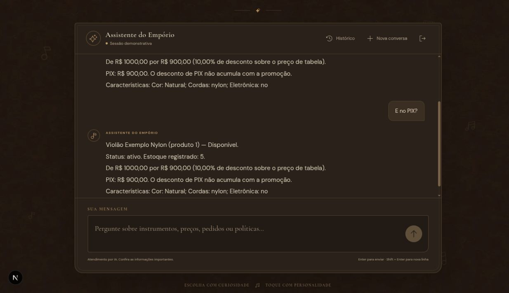

# Catálogo e continuidade no PIX

Execução real pela interface Next.js → API Django → Ollama local (`qwen3:1.7b`).
Base e cliente inteiramente sintéticos. Transcrição integral dos turnos persistidos.
Código e critérios: [contexto dos exemplos](README.md).

## Turno 1

**Usuário**

Quais violões disponíveis até R$ 1000?

**Assistente**

Violão Exemplo Nylon (produto 1) — Disponível.
Status: ativo. Estoque registrado: 5.
De R$ 1000,00 por R$ 900,00 (10,00% de desconto sobre o preço de tabela).
PIX: R$ 900,00. O desconto de PIX não acumula com a promoção.
Características: Cor: Natural; Cordas: nylon; Eletrônica: no

**Registro da execução**

- Data/hora registrada (UTC): `2026-11-04T02:50:06.367387+00:00`.
- Status: `ok`.
- Ferramentas: `search_products`.
- Reparações/rejeições registradas: nenhuma.

## Turno 2

**Usuário**

E no PIX?

**Assistente**

Violão Exemplo Nylon (produto 1) — Disponível.
Status: ativo. Estoque registrado: 5.
De R$ 1000,00 por R$ 900,00 (10,00% de desconto sobre o preço de tabela).
PIX: R$ 900,00. O desconto de PIX não acumula com a promoção.
Características: Cor: Natural; Cordas: nylon; Eletrônica: no

**Registro da execução**

- Data/hora registrada (UTC): `2026-11-04T02:50:31.934936+00:00`.
- Status: `ok`.
- Ferramentas: `get_product`.
- Reparações/rejeições registradas: nenhuma.
