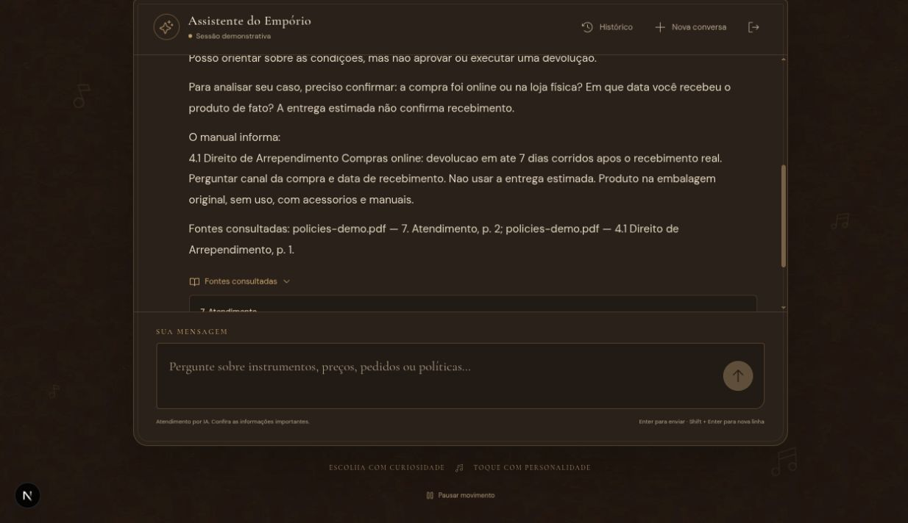

# Pedido e política de devolução

Execução real pela interface Next.js → API Django → Ollama local (`qwen3:1.7b`).
Base e cliente inteiramente sintéticos. Transcrição integral dos turnos persistidos.
Código e critérios: [contexto dos exemplos](README.md).

## Turno 1

**Usuário**

Qual o status do meu pedido 1 e quais são as regras de devolução?

**Assistente**

Pedido 1 — status registrado: Entregue.
Total: R$ 900,00. Pagamento: PIX.
Data do pedido: 2026-01-01.
Entrega estimada: 2026-01-10 (estimativa, não confirmação de recebimento).
Data real de recebimento: não informada.
Rastreio registrado: BR123456789BR.
Estas informações são do banco local; a transportadora não foi consultada.

Posso orientar sobre as condições, mas não aprovar ou executar uma devolução.

Para analisar seu caso, preciso confirmar: a compra foi online ou na loja física? Em que data você recebeu o produto de fato? A entrega estimada não confirma recebimento.

O manual informa:
4.1 Direito de Arrependimento Compras online: devolucao em ate 7 dias corridos apos o recebimento real. Perguntar canal da compra e data de recebimento. Nao usar a entrega estimada. Produto na embalagem original, sem uso, com acessorios e manuais.

Fontes consultadas: policies-demo.pdf — 7. Atendimento, p. 2; policies-demo.pdf — 4.1 Direito de Arrependimento, p. 1.

**Registro da execução**

- Data/hora registrada (UTC): `2026-11-04T02:53:44.424156+00:00`.
- Status: `ok`.
- Ferramentas: `get_order`, `search_policies`.
- Reparações/rejeições registradas: `missing_policy_evidence`.

Fontes:

- policies-demo.pdf, versão demo, 7. Atendimento, p. 2.
- policies-demo.pdf, versão demo, 4.1 Direito de Arrependimento, p. 1.
