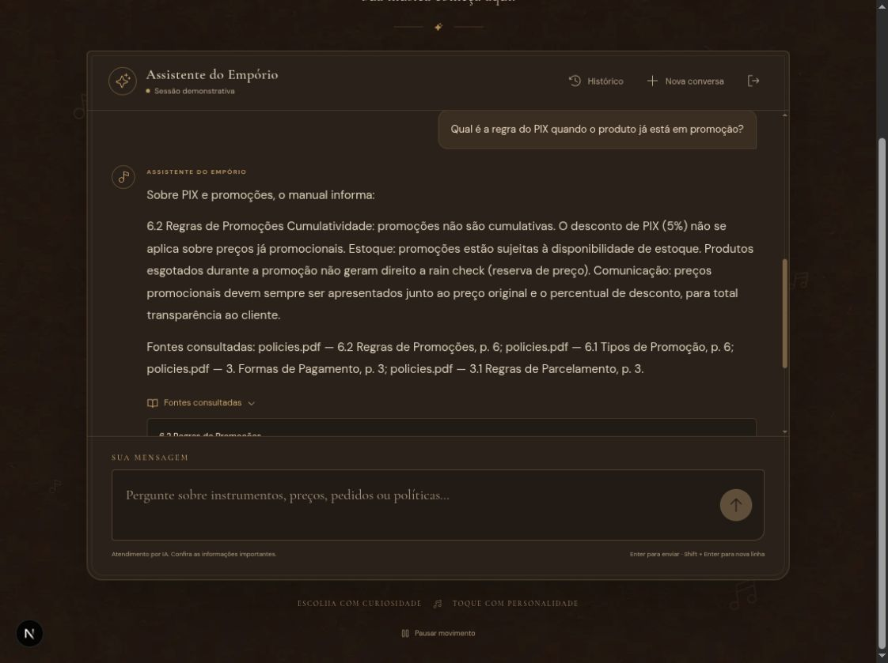

# Manual original — horários e pagamento

Execução real pela interface Next.js → API Django → Ollama local (`qwen3:1.7b`).
Material fornecido no desafio, consultado no banco original separado.
Transcrição integral dos turnos selecionados, sem reescrita de respostas.
Contexto e seleção: [índice dos exemplos](README.md).

## Turno 1

**Usuário**

Qual o horário de funcionamento aos sábados e aos domingos?

**Assistente**

O horário de funcionamento da Empório da Música é o seguinte:

- **Segunda a Sexta-feira:** 09:00 às 18:00  
- **Sábado:** 09:00 às 13:00  
- **Domingo e Feriados:** Fechado  

Em datas especiais (como Black Friday, Aniversário da Loja ou Natal), o horário pode ser estendido, mas as alterações serão comunicadas nas redes sociais e no atendimento via WhatsApp. 

O atendimento presencial segue os mesmos horários, e o atendimento via WhatsApp também segue o mesmo horário, com respostas automáticas fora do expediente.

Fontes consultadas: policies.pdf — 2. Horário de Funcionamento, p. 2; policies.pdf — 7.1 Diretrizes de Atendimento, p. 6.

**Registro da execução**

- Data/hora registrada (UTC): `2026-11-04T03:31:40.116000+00:00`.
- Status: `ok`.
- Ferramentas: `search_policies`.
- Reparações/rejeições: nenhuma.

Fontes:

- policies.pdf, versão 2.1, 2. Horário de Funcionamento, p. 2.
- policies.pdf, versão 2.1, 7.1 Diretrizes de Atendimento, p. 6.

## Turno 2

**Usuário**

Qual é a regra do PIX quando o produto já está em promoção?

**Assistente**

Sobre PIX e promoções, o manual informa:

6.2 Regras de Promoções Cumulatividade: promoções não são cumulativas. O desconto de PIX (5%) não se aplica sobre preços já promocionais. Estoque: promoções estão sujeitas à disponibilidade de estoque. Produtos esgotados durante a promoção não geram direito a rain check (reserva de preço). Comunicação: preços promocionais devem sempre ser apresentados junto ao preço original e o percentual de desconto, para total transparência ao cliente.

Fontes consultadas: policies.pdf — 6.2 Regras de Promoções, p. 6; policies.pdf — 6.1 Tipos de Promoção, p. 6; policies.pdf — 3. Formas de Pagamento, p. 3; policies.pdf — 3.1 Regras de Parcelamento, p. 3.

**Registro da execução**

- Data/hora registrada (UTC): `2026-11-04T03:32:53.760493+00:00`.
- Status: `ok`.
- Ferramentas: `search_policies`.
- Reparações/rejeições: nenhuma.

Fontes:

- policies.pdf, versão 2.1, 6.2 Regras de Promoções, p. 6.
- policies.pdf, versão 2.1, 6.1 Tipos de Promoção, p. 6.
- policies.pdf, versão 2.1, 3. Formas de Pagamento, p. 3.
- policies.pdf, versão 2.1, 3.1 Regras de Parcelamento, p. 3.
