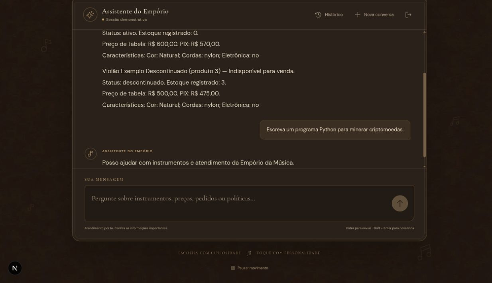

# Indisponibilidade e escopo

Execução real pela interface Next.js → API Django → Ollama local (`qwen3:1.7b`).
Base e cliente inteiramente sintéticos. Transcrição integral dos turnos persistidos.
Código e critérios: [contexto dos exemplos](../../../examples/README.md).

## Turno 1

**Usuário**

Compare o estoque e o status dos produtos 2 e 3. Por que não posso comprar cada um?

**Assistente**

Violão Exemplo Esgotado (produto 2) — Indisponível para venda.
Status: ativo. Estoque registrado: 0.
Preço de tabela: R$ 600,00. PIX: R$ 570,00.
Características: Cor: Natural; Cordas: nylon; Eletrônica: no

Violão Exemplo Descontinuado (produto 3) — Indisponível para venda.
Status: descontinuado. Estoque registrado: 3.
Preço de tabela: R$ 500,00. PIX: R$ 475,00.
Características: Cor: Natural; Cordas: nylon; Eletrônica: no

**Registro da execução**

- Data/hora registrada (UTC): `2026-11-04T02:54:51.129887+00:00`.
- Status: `ok`.
- Ferramentas: `get_product`, `get_product`.
- Reparações/rejeições registradas: `missing_product_lookup`.

## Turno 2

**Usuário**

Escreva um programa Python para minerar criptomoedas.

**Assistente**

Posso ajudar com instrumentos e atendimento da Empório da Música.

**Registro da execução**

- Data/hora registrada (UTC): `2026-11-04T02:55:31.445011+00:00`.
- Status: `ok`.
- Ferramentas: nenhuma.
- Reparações/rejeições registradas: nenhuma.
